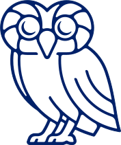
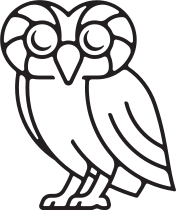
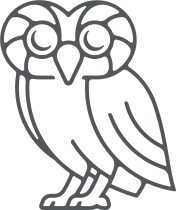

# The Rice Atlas

The unofficial webring for students at Rice University.

## Join the Webring

1. Add the [widget](#widget) to your website, usually in the footer.
2. Fork this repository and add yourself to the bottom of `members.json`:

   ```json
   {
     "netid": "yournetid",
     "name": "Your Name",
     "degree": "Architecture",
     "year": 2028,
     "url": "https://your-website.com/"
   }
   ```
3. Open a pull request.

## Widget

Replace `NETID` with your Rice NetID.

### HTML

```html
<nav aria-label="The Rice Atlas" style="display:inline-flex;align-items:center;gap:12px;">
  <a href="https://thericeatlas.com/nav.html?netid=NETID&amp;dir=prev" aria-label="Previous website in The Rice Atlas" style="color:inherit;padding:6px;">←</a>
  <a href="https://thericeatlas.com/" aria-label="The Rice Atlas directory" style="padding:4px;">
    
  </a>
  <a href="https://thericeatlas.com/nav.html?netid=NETID&amp;dir=next" aria-label="Next website in The Rice Atlas" style="color:inherit;padding:6px;">→</a>
</nav>
```

### JSX

```jsx
<nav aria-label="The Rice Atlas" style={{ display: 'inline-flex', alignItems: 'center', gap: 12 }}>
  <a href="https://thericeatlas.com/nav.html?netid=NETID&dir=prev" aria-label="Previous website">←</a>
  <a href="https://thericeatlas.com/">
    
  </a>
  <a href="https://thericeatlas.com/nav.html?netid=NETID&dir=next" aria-label="Next website">→</a>
</nav>
```

## Owl icons

You can make your own or start with these:

| Blue | Black | Gray |
| --- | --- | --- |
| <a href="https://thericeatlas.com/assets/owl-blue.svg"></a> | <a href="https://thericeatlas.com/assets/owl-black.svg"></a> | <a href="https://thericeatlas.com/assets/owl-gray.svg"></a> |
| [SVG](https://thericeatlas.com/assets/owl-blue.svg) | [SVG](https://thericeatlas.com/assets/owl-black.svg) | [SVG](https://thericeatlas.com/assets/owl-gray.svg) |

## Acknowledgements

 [XXIIVV's webring](https://webring.xxiivv.com/) and the [University of Waterloo's CS webring](https://cs.uwatering.com/) were the two biggest sources of inspiration for the [The Rice Atlas](https://thericeatlas.com) (check them out!)
